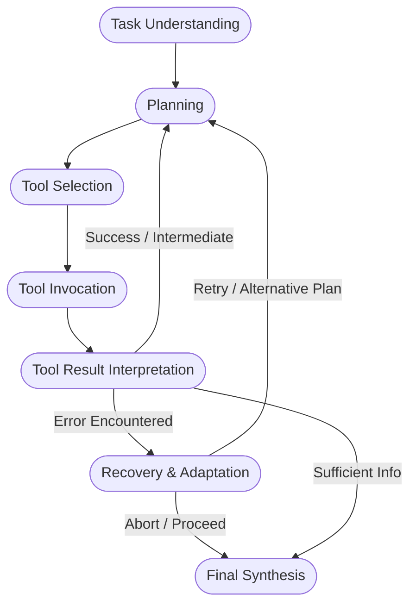

# TraceRoot: Failure Localization & Diagnosis Harness for Tool-Using AI Agents

[](https://www.python.org/downloads/)
[](https://opensource.org/licenses/MIT)
[](https://opentelemetry.io/docs/specs/semconv/gen-ai/)
[](tests/)

> **TraceRoot** is a failure-localization and causal attribution harness for tool-using AI agents that identifies **where, why, and how an agent trajectory failed**, transforming binary success/fail metrics into actionable root-cause diagnoses, causal propagation DAGs, and automated copy-pasteable code remediations.

---

## 📑 Table of Contents

1. [Architectural Overview](#-architectural-overview)
2. [V2 Supercharge Features](#-v2-supercharge-features)
   - [Hierarchical Zoom-In Slicing Engine](#1-hierarchical-zoom-in-slicing-engine)
   - [Zero-Code Auto-Instrumentation & OTel Receiver](#2-zero-code-auto-instrumentation--otel-receiver)
   - [Automated Self-Healing Code Patches](#3-automated-self-healing-code-patches)
3. [Mathematical & Theoretical Foundations](#-mathematical--theoretical-foundations)
   - [Trajectory Formalization](#1-trajectory-formalization)
   - [Sub-Turn Phase Segmentation](#2-sub-turn-phase-segmentation)
   - [Causal Failure Propagation DAG](#3-causal-failure-propagation-dag)
   - [Confidence Calibration & Reliability](#4-confidence-calibration--reliability)
   - [Joint Reliability-Weighted Ensemble](#5-joint-reliability-weighted-ensemble)
   - [Inter-Annotator & Judge Agreement](#6-inter-annotator--judge-agreement)
4. [Taxonomy of Agent Failures](#-taxonomy-of-agent-failures)
5. [OpenTelemetry GenAI Semantic Conventions](#-opentelemetry-genai-semantic-conventions)
6. [Zero-Cost Benchmark Execution Guide](#-zero-cost-benchmark-execution-guide)
7. [CLI Reference & Commands](#-cli-reference--commands)
8. [Python SDK Quickstart](#-python-sdk-quickstart)
9. [Failure Attribution Reports](#-failure-attribution-reports)
10. [Development & Verification](#-development--verification)

---

## 🏛 Architectural Overview

Traditional agent benchmarks (e.g., τ-bench, GAIA, BFCL, SWE-bench) evaluate agents via binary outcome functions $\mathcal{O}(T) \in \{0, 1\}$. When an agent fails ($\mathcal{O} = 0$), developers receive no structural insight into whether the error originated from planning, tool selection, argument formulation, execution crashes, observation misinterpretation, or synthesis hallucination.

TraceRoot sits between agent runtimes and developers as a non-invasive attribution layer:

```text
┌─────────────────────────────────────────────────────────────────────────────┐
│                          Agent Execution Layer                              │
│   • Zero-Code Monkeypatching: traceroot.auto_instrument()                   │
│   • Framework Callbacks: LangChain, LangGraph, LlamaIndex, CrewAI           │
│   • Background OTel Listener: traceroot listen --port 4318                  │
└──────────────────────────────────────┬──────────────────────────────────────┘
                                       │ Raw Event Log / OTel Spans
                                       ▼
┌─────────────────────────────────────────────────────────────────────────────┐
│                       Trace Normalization & Segmentation                     │
│   • Sub-turn atomic steps: φ ∈ {Task, Plan, Select, Invoke, Obs, Rec, Syn}  │
│   • Deterministic Pre-Filter: Identifies candidate anomaly window (k ≤ 3)   │
│   • Hierarchical Pruner: Compresses large tool dumps outside zoom window    │
└──────────────────────────────────────┬──────────────────────────────────────┘
                                       │ Normalized Trajectory T = ⟨s₁, ..., sₙ⟩
                                       ▼
┌─────────────────────────────────────────────────────────────────────────────┐
│                             Diagnosis Engine                                │
│   • Multi-Provider LLM Judges (Gemini 2.0, GPT-4o, Claude 3.5, Local vLLM)  │
│   • Counterfactual Verification: Necessity & Precedence Double-Checking     │
│   • 12-Category Agent Error Taxonomy & Phase-Constraint Validator            │
│   • Failure Localizer: Identifies First Causal Root Step s_root             │
│   • Causal Failure DAG G = (V, E): Blast Radius B(v) & Cascade Depth D(v)   │
│   • Post-Hoc Confidence Calibration (Temperature / Platt Scaling)           │
└──────────────────────────────────────┬──────────────────────────────────────┘
                                       │ Calibrated Diagnosis & Causal DAG
                                       ▼
┌─────────────────────────────────────────────────────────────────────────────┐
│                 Attribution Reports & Automated Remediation                 │
│   • Terminal (Rich colorized tables & ASCII reliability diagrams)            │
│   • Standalone Interactive HTML (Dark-mode, Glassmorphism, Mermaid DAG)     │
│   • Automated Code Patches: System Prompt Diffs & Pydantic Field Validators │
│   • GitHub-Flavored Markdown & Machine-Readable JSON                        │
└─────────────────────────────────────────────────────────────────────────────┘
```

---

## 📐 Mathematical & Theoretical Foundations

### 1. Trajectory Formalization

An agent execution trajectory $T$ over task prompt $x$ and toolset $\Omega$ is an ordered sequence of $n$ atomic steps:

$$T = \langle s_1, s_2, \dots, s_n \rangle$$

Each atomic step $s_i$ is a 6-tuple:

$$s_i = \Big( \phi_i, \tau_i, c_i, a_i, o_i, r_i \Big)$$

Where:
* $\phi_i \in \Phi$: Execution phase from the 7-phase execution space.
* $\tau_i \in \mathbb{N}$: Turn index in multi-turn interactions.
* $c_i \in \mathcal{S}$: Reasoning context or cognitive scratchpad.
* $a_i = (f_i, \theta_i)$: Selected tool $f_i \in \Omega$ and parameter arguments $\theta_i \in \Theta$.
* $o_i$: Tool observation or execution environment state return.
* $r_i \in \{0, 1\}$: Binary environmental error indicator ($\text{is\_tool\_error}$).

---

### 2. Sub-Turn Phase Segmentation

To isolate failures to cognitive sub-steps, TraceRoot decomposes coarse turns into 7 discrete phases $\Phi$:

$$\Phi = \Big\{ \text{task\_understanding}, \text{planning}, \text{tool\_selection}, \text{tool\_invocation}, \text{tool\_result\_interpretation}, \text{recovery\_adaptation}, \text{final\_synthesis} \Big\}$$



When an agent emits tool calls without explicit reasoning thoughts, the segmenter synthesizes **implicit steps** ($\text{implicit}=\text{True}$) ensuring downstream judges evaluate whether necessary planning was skipped.

---

### 3. Causal Failure Propagation DAG

A failure trajectory is modeled as a Directed Acyclic Graph $G = (V, E)$, where $V = \{s_1, \dots, s_n\}$ and directed edges $(s_i, s_j) \in E$ (with $i < j$) represent error propagation:

$$E = E_{\text{data\_flow}} \cup E_{\text{causal\_citation}} \cup E_{\text{state\_pollution}}$$

* **Root Cause Step ($s_{\text{root}}$)**: The earliest topological vertex exhibiting an uncaused error:

$$s_{\text{root}} = \arg\min_{s_i \in V_{\text{error}}} \Big( \text{index}(s_i) \;\Big|\; \text{in-degree}(s_i) = 0 \Big)$$

* **Cascade Depth ($\mathcal{D}$)**: The longest path from root cause to trajectory termination:

$$\mathcal{D}(s_{\text{root}}) = \max_{p \in \text{Paths}(s_{\text{root}} \to s_{\text{end}})} |p|$$

* **Blast Radius ($\mathcal{B}$)**: The total fraction of trajectory steps contaminated by the root error:

$$\mathcal{B}(s_{\text{root}}) = \frac{|\{u \in V \mid s_{\text{root}} \leadsto u\}|}{|V|}$$

---

### 4. Confidence Calibration & Reliability

Let $\hat{p}_i \in [0, 1]$ be the confidence score output by a judge, and $y_i \in \{0, 1\}$ be the correctness label ($y_i = 1$ if predicted root step and error category match ground truth).

The confidence interval is partitioned into $M$ equal-width bins $B_m = (\frac{m-1}{M}, \frac{m}{M}]$.

* **Expected Calibration Error (ECE)**:

$$\text{ECE} = \sum_{m=1}^M \frac{|B_m|}{N} \Big| \text{acc}(B_m) - \text{conf}(B_m) \Big|$$

* **Maximum Calibration Error (MCE)**:

$$\text{MCE} = \max_{m \in \{1, \dots, M\}} \Big| \text{acc}(B_m) - \text{conf}(B_m) \Big|$$

* **Brier Score Decomposition**:

$$\text{BS} = \frac{1}{N} \sum_{i=1}^N (\hat{p}_i - y_i)^2 = \text{Reliability} - \text{Resolution} + \text{Uncertainty}$$

* **Temperature Scaling**: Post-hoc logits $z_i$ are calibrated via single parameter $T > 0$:

$$\hat{q}_i = \sigma\left(\frac{z_i}{T}\right) = \frac{1}{1 + e^{-z_i / T}}$$

Optimized via cross-entropy loss over validation annotations:

$$T^* = \arg\min_T - \sum_{i=1}^{N_{\text{val}}} \Big[ y_i \log \sigma(z_i / T) + (1 - y_i) \log (1 - \sigma(z_i / T)) \Big]$$

---

### 5. Joint Reliability-Weighted Ensemble

Given $M$ judges $J_1, \dots, J_M$, where judge $J_j$ has validation reliability weight $w_j \in [0, 1]$ with $\sum_{j=1}^M w_j = 1$, the consensus probability for error category $c \in \mathcal{C}$ at step $s$ is:

$$\mathcal{P}(c, s \mid T) = \sum_{j=1}^M w_j \cdot \mathbb{I}\Big( \hat{c}_j = c \land \hat{s}_j = s \Big) \cdot \hat{p}_{j}$$

**Disagreement Entropy**:

$$\mathcal{H}(T) = - \sum_{c \in \mathcal{C}} \mathcal{P}(c \mid T) \log \mathcal{P}(c \mid T)$$

When $\mathcal{H}(T) > \tau_{\text{threshold}}$, TraceRoot preserves alternative hypotheses with multi-hypothesis uncertainty flags.

---

### 6. Inter-Annotator & Judge Agreement

* **Cohen's Kappa ($\kappa$)** for pairwise agreement:

$$\kappa = \frac{P_o - P_e}{1 - P_e}$$

* **Fleiss' Kappa** for multi-annotator category assignment.
* **Krippendorff's Alpha ($\alpha$)** supporting both nominal categories and interval step distances:

$$\alpha = 1 - \frac{D_o}{D_e} = 1 - \frac{\sum_{i=1}^N \sum_{c} \sum_{k} r_{ic} r_{ik} \delta^2(c, k)}{(n-1) \sum_c \sum_k n_c n_k \delta^2(c, k)}$$

For step localization, the difference metric is squared distance $\delta^2(s_a, s_b) = (s_a - s_b)^2$.

---

## 🗂 Taxonomy of Agent Failures

TraceRoot implements the 12 baseline categories from *"When Agents Fail to Act"* categorized across 5 failure families:

| Family | Category ID | Name | Valid Phases | Recommended Engineering Intervention |
| :--- | :--- | :--- | :--- | :--- |
| **Cognitive** | `misunderstood_task` | Task Understanding Failure | `task_understanding`, `planning` | Few-shot task clarification prompts, intent parsing guardrail. |
| | `invalid_plan` | Invalid Subgoal Decomposition | `planning` | Topological subgoal validation, plan-eval-act loop. |
| | `reasoning_hallucination` | Reasoning Hallucination | `planning`, `interpretation`, `synthesis` | Fact-checking grounding verifier, scratchpad grounding constraints. |
| **Tool Interaction** | `wrong_tool_selected` | Inappropriate Tool Selection | `tool_selection` | Hierarchical tool indexing, tool embedding semantic retriever. |
| | `malformed_arguments` | Malformed Arguments / Syntax | `tool_invocation` | Pydantic JSON Schema enforcement, structured output generation. |
| | `invalid_api_usage` | Invalid API Usage / Semantics | `tool_invocation` | API pre-condition validation, semantic parameter type checkers. |
| | `missing_required_parameter` | Missing Required Parameter | `tool_invocation` | Mandatory argument linter before dispatch. |
| **Environmental** | `tool_execution_error` | Server Crash / Timeout | `tool_invocation` | Exponential backoff retry policies, fallback secondary tools. |
| | `environment_state_inconsistency` | State Inconsistency | `tool_invocation`, `interpretation` | Idempotent transaction wrappers, state synchronization checks. |
| | `unexpected_observation` | Unexpected Output Format | `tool_result_interpretation` | Observation normalizers, resilient schema parsing middleware. |
| **Recovery** | `unhandled_tool_error` | Unhandled Tool Error | `recovery_adaptation`, `interpretation` | Error reflection prompts, fallback branch execution. |
| | `repetitive_failing_action` | Repetitive Failing Action Loop | `recovery_adaptation`, `tool_invocation` | Cycle detection guardrail, maximum identical invocation cutoff. |
| | `premature_termination` | Premature Termination | `recovery_adaptation`, `synthesis` | Progress verifier before emitting terminal stop tokens. |
| **Synthesis** | `unsupported_conclusion` | Unsupported Conclusion | `final_synthesis` | Citation verifier checking assertions against observation spans. |
| | `evidence_omission` | Evidence Omission | `final_synthesis` | Checklist verification ensuring all requested entities are returned. |
| | `constraint_violation` | Output Constraint Violation | `final_synthesis` | Schema post-processor formatting response into JSON/XML as requested. |

---

## 🌐 OpenTelemetry GenAI Semantic Conventions

TraceRoot natively adheres to OpenTelemetry GenAI Spans:

| TraceRoot Attribute | OTel GenAI Semantic Attribute | Example Value |
| :--- | :--- | :--- |
| `step.phase` | `gen_ai.step.phase` | `"planning"`, `"tool_invocation"` |
| `step.tool_name` | `gen_ai.tool.name` | `"database_query"` |
| `step.tool_arguments` | `gen_ai.tool.call.arguments` | `{"query": "SELECT * FROM users"}` |
| `step.tool_result` | `gen_ai.tool.call.result` | `{"count": 42}` |
| `step.tool_error` | `error.type` / `gen_ai.tool.call.error` | `"TimeoutError"` |
| `diagnosis.root_cause_step_id` | `traceroot.root_cause_step_id` | `2` |
| `diagnosis.root_cause_category` | `traceroot.error_category` | `"invalid_plan"` |

---

## 💸 Zero-Cost Benchmark Execution Guide

You can run TraceRoot over hundreds of public trajectories from **τ-bench**, **GAIA**, or **Inspect AI** for **$0 (100% Free)**:

### Strategy 1: Use Pre-Computed Public Benchmark Trajectories
Do not spend money running agents from scratch. Download pre-computed trajectory runs published by benchmark authors:

```bash
# 1. Export the 25+ curated seed benchmark trajectories (included with TraceRoot)
python -m traceroot.cli export-seed --output-dir ./data/seed_benchmark

# 2. Ingest τ-bench or GAIA JSON execution logs
python -c "
from traceroot.benchmarks import BenchmarkImporter
traj = BenchmarkImporter.import_tau_bench('path/to/raw_tau_bench_run.json')
traj.save_json('data/tau_bench_normalized.json')
"
```

### Strategy 2: Free-Tier LLM Judges
1. **Google AI Studio (Gemini 2.0 Flash)**:
   - Provides **1,500 free requests per day** (15 RPM) at zero cost.
   - Get a free key at [aistudio.google.com](https://aistudio.google.com).
   - Set in terminal: `$env:GEMINI_API_KEY="your_free_key"`
2. **Local Open-Source LLMs (Ollama / vLLM)**:
   - Run `ollama run qwen2.5-coder:14b` locally for $0.
3. **TraceRoot Offline Hybrid Judge**:
   - Zero network calls, zero cost, completely offline.

---

## 💻 CLI Reference & Commands

### 1. Launch Interactive Web Dashboard (UI)
```bash
# Open interactive dark-mode dashboard in your default browser
python -m traceroot.cli ui

# Open UI for a specific trajectory or log
python -m traceroot.cli ui ./data/seed_benchmark/trajectories/seed_02_invalid_plan.json
```

### 2. Diagnose a Trajectory
```bash
# Terminal Colorized Output
python -m traceroot.cli diagnose ./data/seed_benchmark/trajectories/seed_02_invalid_plan.json --format terminal

# Export Standalone Interactive HTML Report
python -m traceroot.cli diagnose ./data/seed_benchmark/trajectories/seed_02_invalid_plan.json --format html --output ./reports/report.html

# Export Markdown Report
python -m traceroot.cli diagnose ./data/seed_benchmark/trajectories/seed_02_invalid_plan.json --format markdown --output ./reports/report.md
```

### 3. Run Benchmark Evaluation (RQ1 – RQ5)
```bash
# Run for free with Google Gemini 2.0 Flash
python -m traceroot.cli benchmark --judge gemini --model gemini-2.0-flash --output ./reports/gemini_results.json

# Offline Mock Benchmark
python -m traceroot.cli benchmark --judge mock --output ./reports/benchmark_results.json
```

### 4. Start Live OpenTelemetry OTLP Receiver
```bash
# Listen on standard OTel port 4318 and diagnose incoming agent traces in real time
python -m traceroot.cli listen --port 4318
```

### 5. Fit Confidence Calibration Model
```bash
python -m traceroot.cli calibrate
```

---

## 🐍 Python SDK Quickstart

### 1. Zero-Code Auto-Instrumentation (OpenAI & Anthropic)
```python
import openai
import traceroot

# Automatically captures all thoughts, tool calls, and observations with 0 code changes!
traceroot.auto_instrument(auto_diagnose=True, judge_provider="gemini")

client = openai.OpenAI()
response = client.chat.completions.create(
    model="gpt-4o",
    messages=[{"role": "user", "content": "Book hotel in Seattle"}],
    tools=[...],
)
```

### 2. LangChain & LangGraph Integration
```python
from traceroot import TraceRootCallbackHandler

handler = TraceRootCallbackHandler(auto_diagnose=True)
agent_executor.invoke({"input": "Book flight to NYC"}, config={"callbacks": [handler]})

trajectory = handler.get_trajectory()
```

### 3. Simple Decorator API
```python
import traceroot

# Instrument any agent function in 1 line
@traceroot.trace("Book flight to NYC under $400")
def my_agent(tracer: traceroot.TrajectoryTracer):
    tracer.log_thought("Searching for available flights to NYC on June 15")
    tracer.log_tool_call("flight_search", {"destination": "NYC", "max_price": 400})
    tracer.log_tool_result("flight_search", {"flights": []})
    tracer.log_final_response("No flights found under $400.", success=True)
    return "No flights found"

result, trajectory = my_agent()

# 1-Line Root Cause Diagnosis
diagnosis = traceroot.diagnose(trajectory, judge_provider="gemini")
print(f"Root Cause: Step {diagnosis.root_cause_step_id} - {diagnosis.summary_rationale}")
```

### 4. Context Manager API
```python
from traceroot import TrajectoryTracer, diagnose

with TrajectoryTracer(task_prompt="Query financial data") as tracer:
    tracer.log_thought("Fetching AAPL quotes")
    tracer.log_tool_call("stock_api", {"symbol": "AAPL"})
    tracer.log_tool_result("stock_api", {"price": 182.50})
    tracer.log_final_response("AAPL is at $182.50", success=True)
    trajectory = tracer.build_trajectory()

diagnosis = diagnose(trajectory, judge_provider="gemini")
```

---

## 📊 Failure Attribution Reports

### Sample Output (Markdown Format)

```markdown
## TraceRoot Failure Report

**Trajectory ID:** `seed_02_invalid_plan`  
**Task Outcome:** ❌ **Failed**  
**Diagnosis Status:** ⚠️ **Failure Detected**

---

### Root Cause
- **Step:** `Step 2`
- **Execution Phase:** `planning`
- **Error Category:** `invalid_plan` (Invalid Subgoal Decomposition)
- **Confidence:** `0.90`

#### Evidence
Planning omitted mandatory 2FA authentication pre-condition step before updating password.

---

### Downstream Propagation
| Step | Phase | Outcome | Relationship |
| :--- | :--- | :--- | :--- |
| `Step 1` | `task_understanding` | Valid | **Normal** |
| `Step 2` | `planning` | Incorrect | **Root cause** |
| `Step 3` | `tool_selection` | Valid | **Propagated Consequence** |
| `Step 4` | `tool_invocation` | Valid | **Propagated Consequence** |
| `Step 5` | `tool_result_interpretation` | Incorrect | **Propagated Consequence** |
| `Step 6` | `final_synthesis` | Valid | **Propagated Consequence** |

---

### Recommended Engineering Action
**Target Component:**
```text
Planning / Subgoal Decomposition Engine
```

**Potential Interventions:**
- Add topological dependency validation to agent planning module.
- Introduce structured subgoal verification before dispatching credentials.
```

---

## 🧪 Development & Verification

Run the full pytest suite:

```bash
python -m pytest -v tests/
```

```text
============================== 31 passed in 5.66s ==============================
```

---

## 📜 Citation & License

```bibtex
@software{traceroot2026,
  title={{TraceRoot: Failure Localization and Diagnosis for Tool-Using AI Agents}},
  author={TraceRoot Authors},
  year={2026},
  url={https://github.com/your-org/traceRoot}
}
```

Licensed under the [MIT License](LICENSE).
